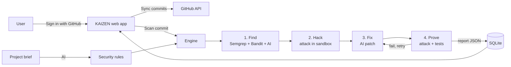

# KAIZEN — Project Brief

> Working name. Change it once the team agrees on a final one.

**Hackathon:** HackOnTrack · **Domain:** Cyber Security · **Time:** 24 hours

## 1. Problem statement

> Given a vulnerable open-source repository, build an AI agent that locates the security bug, writes a patch, and proves the fix does not break the existing test suite.

## 2. One-line pitch

**"Scanners say *maybe*. KAIZEN hacks your code, fixes it, proves the fix works — and teaches you why."**

## 3. The problem we are solving

Existing tools (static scanners, AI reviewers like CodeRabbit) have four gaps:

1. **They don't prove anything.** They say "this *might* be vulnerable". Developers ignore warnings they can't verify.
2. **They are noisy.** Dozens of comments per pull request, most of them style nitpicks.
3. **They don't understand intent.** They check code patterns, not what the app is *supposed* to do. So they miss logic bugs like "a student can see another student's marks" — Broken Access Control, the #1 risk on the OWASP Top 10.
4. **They don't teach.** A student gets told what's wrong, makes the same mistake next week.

## 4. Our solution: Hack → Fix → Prove

For every commit, the agent runs four steps. Each step is a light on the screen.

| Step | What happens | Light |
|---|---|---|
| **1. Find** | Semgrep + Bandit scan the code; the AI also checks it against the project's security rules (from the brief). The AI picks the real bug and explains it in plain English. | Bug found |
| **2. Hack** | The AI writes a small attack script and runs it in a sandbox. If the attack works, the bug is real. | 🔴 Attack succeeded |
| **3. Fix** | The AI writes a patch. If the attack still works or a test breaks, it retries (max 2 retries). | Patch ready |
| **4. Prove** | Re-run the attack → must be blocked. Re-run the full test suite → must all pass. | 🟢 Attack blocked · 🟢 Tests pass |

**Zero-noise rule:** if we can't prove a bug with a working attack, we don't report it.

## 5. Core features (only these)

1. **Hack → Fix → Prove engine** — the heart of the project. Everything else wraps around it.
2. **Project brief → security rules** — the user describes the app in a short form (what it does, who the users are, who can do what). The AI turns this into a checklist of rules like "only admins can delete users". The engine attacks each commit against these rules. This is how we catch logic bugs that scanners miss.
3. **Commit dashboard** — every commit by every team member, with author, message, time and a state badge. Click a commit to open its report.
4. **Two modes**
   - **Professional (default: Report mode)** — proof of attack, verified patch offered as a pull request to approve, short report.
   - **Student (default: Learn mode)** — fixed code, simple "what you did wrong" explanation, and a learning card with a video and a hands-on practice lab.
   - Either user can switch on the other mode from the Profile page.
5. **Repeat-mistake tracker** — if a user makes the same type of bug again, the report says "2nd time: SQL injection — last time in commit `a3f9`".
6. **GitHub login** — sign in with GitHub. The GitHub username matches commit authors automatically.

## 6. Commit states

| State | Meaning |
|---|---|
| **New** | Commit synced, not scanned yet |
| **Safe** | Scanned, no provable bug found |
| **Fixed** | Bug proven, patch verified (attack blocked + all tests pass) |
| **Needs Attention** | Bug proven, but the auto-fix failed after retries — a human must look |

## 7. How we differ from CodeRabbit

| CodeRabbit | KAIZEN |
|---|---|
| Comments that say "this might be a problem" | Live attack proves the bug is real |
| Suggested fixes, not verified | Fix verified: attack blocked + tests pass |
| Many comments, often noisy | One card per proven bug, nothing else |
| Checks code patterns | Also checks code against what the app is supposed to do (project brief) |
| For professionals only | Student mode teaches and tracks repeat mistakes |

## 8. Scope for 24 hours

**In scope**
- One demo app that we write ourselves (Flask, ~150 lines, with a `pytest` test suite)
- Three bug types:
  - **SQL injection** — search box
  - **Path traversal** — file download
  - **IDOR / broken access control** — student can view another student's marks (caught only through the project brief)
- Python only
- One repo, synced with a "Sync commits" button (GitHub REST API)

**Out of scope** (mention as "future work" in the pitch)
- Any-repo / any-language support
- GitHub webhooks and Checks API (status on GitHub itself)
- Multiple repos, backporting fixes to old versions
- Weakness charts and analytics
- Editing the generated security rules

## 9. Demo app and demo flow

**Demo app:** a small "Student Marks Portal" — login, view marks, search students, download report cards.

**Planted commits** (each pushed by a different team member, so the dashboard shows several authors):

1. Commit adds SQL injection in search
2. Commit adds path traversal in file download
3. Commit adds IDOR in `/marks/<id>`
4. "Student" commit repeats SQL injection → triggers the repeat-mistake badge

**Live demo (about 3 minutes)**

1. Log in with GitHub. Show the project brief and the generated rules.
2. Click **Sync commits** → four commits appear as **New**.
3. Scan the SQL injection commit → lights run → 🔴 attack dumps all users → fix → 🟢 🟢 → **Fixed**.
4. Scan the IDOR commit. First show that Semgrep alone finds nothing. Then our agent logs in as one student and opens another student's marks → 🔴 → fix → 🟢 🟢.
5. Switch to Student mode → learning card with video and practice lab.
6. Scan commit 4 → **"Repeat mistake — 2nd time: SQL injection"**.
7. Close: *"We don't say maybe. We prove it, fix it, and teach it."*

**Safety nets**
- **Replay mode:** every engine run's result is saved; if the AI API is slow on stage, replay the saved run.
- **Backup video** of the full demo, recorded before the presentation.

## 10. Tech stack

| Part | Choice |
|---|---|
| Backend + UI | Python, FastAPI, Jinja templates, Tailwind (CDN) |
| Database | SQLite |
| Login | GitHub OAuth App |
| Scanners | Semgrep, Bandit (CLI, JSON output) |
| AI | Direct LLM API calls in a simple Python loop (no agent framework) |
| Sandbox | Docker with `--network none` (fallback: subprocess with timeout, acceptable only because the demo repo is our own code) |
| Demo app | Flask + pytest |

> Rule: use only tools the team already knows. No new frameworks in 24 hours.

## 11. Architecture



## 12. Report format (the team contract)

Agree on this in hour 0. The frontend builds against fake data in this shape while the engine is still being written.

```json
{
  "commit_sha": "a3f9c1",
  "author": "rahul-dev",
  "state": "Fixed",
  "bug_type": "SQL_INJECTION",
  "explanation": "Search box puts user text directly into the database query.",
  "attack": { "before": "SUCCESS", "evidence": "Returned all 50 users without a password" },
  "fix_diff": "--- a/app.py\n+++ b/app.py\n...",
  "attack_after": "BLOCKED",
  "tests": { "passed": 12, "total": 12 },
  "repeat_count": 2,
  "learning_links": ["https://...", "https://..."]
}
```

## 13. Team roles and timeline

| Role | Owns |
|---|---|
| **A — Engine** | Find → Hack → Fix → Prove loop |
| **B — Demo app** | Demo app, tests, planted bug commits, brief → rules prompt, learning-card links |
| **C — Backend** | FastAPI, GitHub login, SQLite, commit sync, states, repeat counter |
| **D — Frontend + pitch** | Dashboard, report page, profile toggle, slides |

| Hours | Goal |
|---|---|
| 0–1 | Everyone: freeze scope, agree report format, set up repo |
| 1–6 | Each role builds their first half (frontend uses fake JSON) |
| 6–12 | Each role finishes their part |
| 12–14 | Connect everything end to end |
| **14** | **Feature freeze — nothing new after this** |
| 14–18 | Fix bugs, run the full demo 5 times |
| 18–20 | Record backup video, save runs for replay |
| 20–23 | Slides and rehearsal |
| 23–24 | Buffer |

Sleep in 2-hour rotations between hours 14 and 20.

## 14. Open questions

- [ ] Final project name
- [ ] Team size and each member's skills (roles above assume 4 people)
- [ ] Which LLM API do we have credits for?
- [ ] Will the organizers give us a repo to fix at judging time, or do we use our own demo app?
- [ ] Professional mode: auto-apply the fix, or only open a pull request to approve? (Recommended: pull request.)
